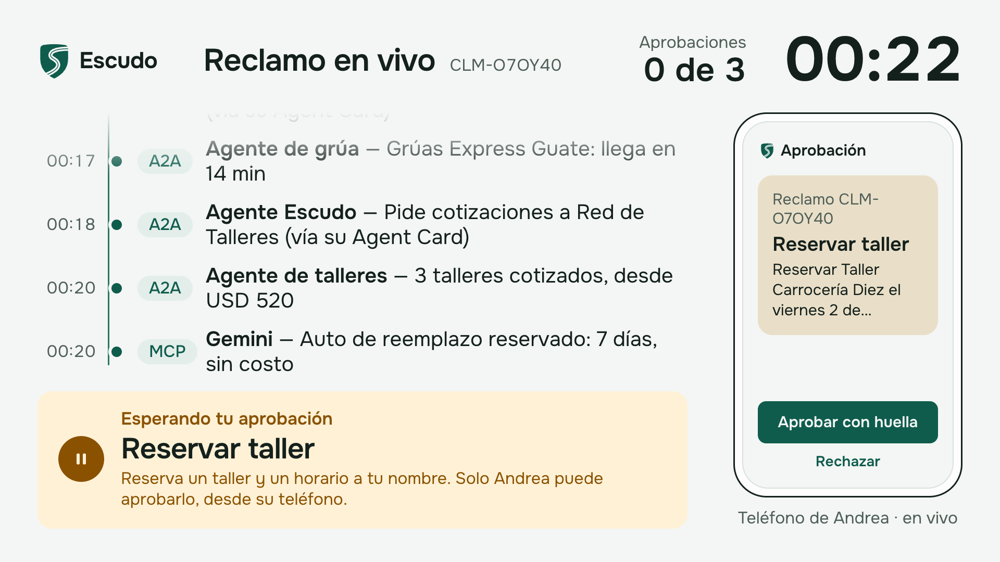

# Escudo — an agent-ready car insurer

> Demo for the talk **"Built for Agents: Making Your Apps Usable by AI"**.
> [Versión en español](README.md) · [Onboarding guide (Spanish)](docs/ONBOARDING.md)

Escudo is a fictional Guatemalan car insurer whose capabilities AI agents can use from three
surfaces: an **Android app with AppFunctions**, a **website with WebMCP** and an **MCP server**. Its
own agent delegates to a tow-truck agent and a repair-shop agent over **A2A**, and the customer talks
to the **Escudo Assistant** by voice (Gemini Live). The talk's scenario — *"tuve un choque menor, aquí
están las fotos, ayúdame con todo"* ("I had a minor crash, here are the photos, help me with
everything") — goes from report to signed claim with **exactly three human approvals**, each one a
fingerprint on the phone.



## What you'll learn

| Idea | Where the code shows it |
| --- | --- |
| **Functions, not screens.** The domain is 11 functions; every surface is a thin adapter over them. | `backend/escudo/capabilities/` (one file per capability, registry in `capabilities/__init__.py`). Adapters: `adapters/rest.py`, `adapters/mcp_server.py`, `adapters/assistant_live.py`, `agents/escudo_agent.py`. All of them go through one door: `gateway.call_capability`. On Android, screens and AppFunctions share `EscudoRepository`; on the web, screens and WebMCP share `api()` |
| **What an agent may do alone and what needs a person.** One table, enforced by the server, not by the prompt. | `backend/escudo/autonomy.py` (`AUTONOMY` table + `enforce()`), `approvals.py` (single-use approval bound to tool + arguments hash). Approving is **never** a tool: only `POST /approvals/{id}/approve` exists, called by the app after `BiometricPrompt` (`android/.../approvals/ApprovalFlow.kt`) |
| **Where MCP fits and where A2A fits.** Tools over MCP; other companies' work over A2A, discovered by Agent Card. | MCP: `adapters/mcp_server.py` (`/mcp`, streamable HTTP). A2A: `agents/hosting.py` (Agent Card at `/.well-known/agent-card.json`), `agents/peers.py` (discovery from `A2A_PEERS`), `agents/tow_agent.py`, `agents/repair_agent.py` |
| **AppFunctions**: the Android app as a tool for system agents. | `android/app/src/main/kotlin/app/escudo/android/appfunctions/EscudoAppFunctions.kt` (`reportAccident`, `getCoverage`, `getClaimStatus`), agent-facing description in `res/xml/app_metadata.xml`. See [`android/APPFUNCTIONS.md`](android/APPFUNCTIONS.md) |
| **WebMCP**: the website as a tool for the browser's agent. | `web/src/lib/webmcp.ts` (`getCoverage`, `getDeductible`, `findRepairShops`, `getClaimStatus`, all read-only) and `web/src/components/portal/WebMcpTools.tsx` (registration with `document.modelContext.registerTool`) |
| **Voice with Gemini Live**: a voice agent with exactly the same powers — and the same pauses — as any MCP client. | `backend/escudo/adapters/assistant_live.py` (ADK `Runner.run_live` + `McpToolset` looping back to `/mcp` with the customer's own token). On Android: `assistant/LiveAssistantSession.kt`, `assistant/VoiceSource.kt` |

## Architecture

[](docs/diagrams/architecture.svg)

([SVG](docs/diagrams/architecture.svg) · [HTML](docs/diagrams/architecture.html))

- **`escudo-api`** (Cloud Run): one FastAPI process with REST, MCP (`/mcp`), voice
  (`/assistant/live`) and three A2A agents (`/a2a/escudo`, `/a2a/tow`, `/a2a/repair`). Every call goes
  through `gateway.call_capability`, which validates input, runs the precheck, applies `autonomy.py`,
  runs the capability and writes the timeline events (validated against `contracts/events.schema.json`).
- **`escudo-web`** (Cloud Run): the customer portal with WebMCP and the `/presenter` view, which reads
  Firestore on the server and streams it to the browser as Server-Sent Events.
- **Escudo for Android** (phone or emulator): policy, claim, fingerprint approvals, the voice Escudo
  Assistant, FCM push and AppFunctions.
- **Firebase**: Auth (customer login), Firestore (database `escudo`), Cloud Storage (claim photos in
  `ai-experiments-487722-escudo-claims`) and FCM (approval push). Vertex AI provides Gemini.

### The scenario, step by step

[](docs/diagrams/crash-sequence.svg)

1. Andrea reports the accident in the app with three photos (`open_claim` + `attach_claim_photos`);
   the damage assessor (multimodal Gemini with structured output) returns parts, severity and cost range.
2. She asks the Escudo Assistant to "help me with everything". Without asking, the assistant calls
   `request_tow` and `list_repair_options` (the Escudo agent delegates over A2A to Grúas Aliadas and the
   Red de Talleres) and `request_rental_car` (automatic because the seeded policy covers it).
3. Three times — `select_repair_shop`, `accept_deductible`, `sign_claim` — the tool returns
   `pending_approval` and changes nothing; a push arrives, Andrea approves with her fingerprint, the
   backend nudges the voice session and the assistant repeats the same call with the `approval_id`.

### Tools, autonomy and surfaces

[](docs/diagrams/tool-autonomy-map.svg)

The full table, with inputs and outputs, is in [`contracts/tools.md`](contracts/tools.md).

## Quickstart

No cloud (everything simulated: `MOCK_AI=1 MOCK_AUTH=1`, in-memory store, deterministic partner agents):

```bash
make up-mock          # API at http://127.0.0.1:8080
make scenario         # in another terminal: the whole scenario over MCP, the 3 approvals simulated
make test             # backend (pytest), Android (unit) and web (vitest)
```

Against the cloud (needs ADC and `.env`; see [docs/ONBOARDING.md](docs/ONBOARDING.md)):

```bash
cp .env.example .env  # and fill in the secrets
make reset CLOUD=1    # put the deployed service back in its initial state
make scenario CLOUD=1 APPROVE_DELAY=4
```

## `make` commands

From the repo root (`make help` lists the main ones):

| Command | What it does |
| --- | --- |
| `make up` | Local API on `:8080` against real Firestore, Storage and Gemini (ADC, `.env`) |
| `make up-mock` | Local API without cloud (`MOCK_AI=1 MOCK_AUTH=1`, `ADMIN_TOKEN=local-admin`) |
| `make web` | Local portal and `/presenter` on `:3217` (`npm run dev`, config in `web/.env.local`) |
| `make seed` | Writes policy, shops and tow providers to Firestore and creates the customer's Firebase Auth login (credentials in `.env.local`) |
| `make reset` | `POST /admin/reset` on `ESCUDO_BASE_URL` (< 10 s). `CLOUD=1` targets the deployed service and uses `infra/.generated/admin_token` |
| `make test` | Backend `pytest` with `MOCK_AI=1 MOCK_AUTH=1`, Android unit tests and web `vitest` |
| `make scenario` | Full scenario over MCP in test mode (`--test-mode --auto-approve`); `CLOUD=1`, `APPROVE_DELAY=4` |
| `make scenario-live` | The same scenario, but it waits for the customer to approve each step on the phone |
| `make deploy` | `deploy-api` + `deploy-web` |
| `make deploy-api` | `infra/10-deploy-api.sh`: builds and deploys `escudo-api` |
| `make deploy-web` | `infra/11-deploy-web.sh`: builds and deploys `escudo-web` |
| `make photos` | Regenerates the rehearsal crash photos with `IMAGE_MODEL` |
| `make android-build` | `./gradlew assembleDebug` (`live` and `fake` flavors) |
| `make android-test` | Android unit tests (both flavors) |
| `make android-install` | Installs and opens the app (`FLAVOR=live` by default, `FLAVOR=fake` for no network) |
| `make android-emulator` | Starts the `Pixel_9_API_36_1` AVD (Android 16 QPR2, needed for `cmd app_function`) |
| `make voice-scenario` | Full **voice** scenario on the emulator, with a virtual fingerprint, timed |

`android/Makefile` adds `make -C android live-test` (instrumented voice test against the cloud),
`google-services` (downloads `google-services.json`) and `appfunctions` (lists the AppFunctions on the device).

## Repo map

```
AGENTS.md                 guide for coding agents (spec and rules)
Makefile                  the commands above
.env.example              variables (models, data, surfaces, modes); copy to .env
contracts/                shared source of truth
  openapi.yaml            REST API (Android and web)
  tools.md                the 11 capabilities, autonomy, surfaces, approval protocol, voice and push
  events.schema.json      schema of the timeline events
  CHANGELOG.md            changes (all backward compatible)
backend/                  Python 3.13 + uv
  escudo/capabilities/    the domain: one function per capability
  escudo/autonomy.py      what an agent may do alone
  escudo/approvals.py     single-use approvals
  escudo/gateway.py       the one door into the domain
  escudo/adapters/        REST, MCP and voice (Gemini Live)
  escudo/agents/          Escudo agent + Tow and Repair partners over A2A
  escudo/damage_assessor.py  damage assessor (Gemini, structured output)
  escudo/scenario.py      scenario runner over MCP
  escudo/seed.py, admin.py   synthetic data, make seed / make reset
  samples/photos/         3 rehearsal photos + prompts.json
  scripts/                generate_sample_photos.py, assistant_probe.py
  tests/                  pytest (approvals, autonomy, A2A discovery, events, scenario)
android/                  Kotlin + Compose + Material 3 (see android/README.md)
  app/src/main/…/appfunctions/   AppFunctions
  app/src/main/…/approvals/      ApprovalFlow + BiometricPrompt
  app/src/main/…/assistant/      voice session, VoiceSource (microphone or WAV)
  scripts/voice_scenario.sh      voice scenario on the emulator
  testdata/voice/                Spanish recordings for rehearsals
web/                      Next.js 16 (see web/README.md)
  src/lib/webmcp.ts       WebMCP tools
  src/app/presenter/      presenter view (1920×1080)
infra/                    numbered gcloud scripts (APIs, service accounts, deploys)
docs/                     ONBOARDING.md, diagrams and screenshots
```

## Technical decisions

| Decision | Why | Discarded alternatives |
| --- | --- | --- |
| **One Cloud Run service with Tow and Repair inside it, but A2A only.** The three agents are mounted in `escudo-api` under `/a2a/escudo`, `/a2a/tow` and `/a2a/repair`, each with its own Agent Card. | One deploy, one cold start and one service account. The Escudo agent only knows base URLs (`A2A_PEERS`), reads the Agent Card, indexes by skill and calls the RPC URL the card declares (`agents/peers.py`); it never imports partner code. `tests/test_discovery.py` checks this, including that `escudo_agent.py` contains no partner paths. | Three separate services (more deploys and cold starts without teaching anything new). Calling the partners' functions directly (it would hide the A2A lesson). |
| **A single instance (`--min-instances=1 --max-instances=1`).** | The "the customer approved" nudge travels from `POST /approvals/{id}/approve` to the open voice session through an in-memory `AssistantHub`; both must live in the same process. ADK sessions and the A2A task store are in memory too. `min-instances=1` avoids a cold start on stage; `--no-cpu-throttling`, `--timeout=3600` and `--session-affinity` keep the voice WebSocket alive. One presenter, one customer: one instance is plenty. | A cross-instance channel (Pub/Sub or a Firestore listener) to fan out nudges: more parts that can fail on stage. |
| **Approval bound to tool + arguments hash, single use.** | `approvals.args_hash` is the SHA-256 of the canonical JSON `{tool, args}` (without `approval_id` or nulls). `redeem` checks customer, tool, hash and status inside one atomic update and marks the approval `used`. An approval for "Taller Carrocería Diez on Tuesday" does not work for another shop, another slot, or twice. Before asking, the server runs the precheck so a customer is never asked to approve something that would fail. A misused approval (other tool or other data) is not burned. | Telling the model in the prompt to "ask first" (a prompt is not a control). Exposing `approve` as a tool (the agent would approve itself). A generic "yes" token not bound to the action shown. |
| **Optional A2A shared secret (`A2A_SHARED_SECRET`).** | Tow and Repair only answer RPC carrying `X-Escudo-A2A-Key` (compared with `hmac.compare_digest` in `main.partner_key_guard`). Their Agent Cards stay public — discovery must work — and declare the `securitySchemes.partnerKey` scheme, so a caller learns *how* to authenticate from the card. The Escudo agent (`/a2a/escudo`) stays open because customers' agents are meant to reach it. `make deploy` generates the secret into `infra/.generated/a2a_secret`; empty locally and in tests. | OAuth or mTLS between partners: right between real companies, out of proportion for partners living in the same service. |
| **Phone mirror drawn from backend state.** | The right panel of `/presenter` (`web/src/components/presenter/PhoneMirror.tsx`) shows what the app shows — pending approval first, then the claim — from the same Firestore data. It does not depend on USB, the emulator or a capture process, and it always matches the timeline. | Screen capture with `scrcpy` as the main source (kept as an option for pixel-exact mirroring: a `scrcpy` window over the panel). A custom stream from the app. |
| **Recorded voice for rehearsals on the emulator.** | The assistant listens through a `VoiceSource`: `MicrophoneSource` in production or `FileSource`, which plays a PCM16 16 kHz mono WAV in real time through the same path (40 ms chunks → WebSocket → Gemini Live → MCP). With `-allow-host-audio` the laptop microphone reached the emulator at a 0.013 peak, too low; the recordings (`android/testdata/voice/`, made with `say -v Paulina` + ffmpeg) make rehearsals repeatable, and `make voice-scenario` times them (168 s end to end on 2026-09-30). Only debug builds contain them. Releasing the button sends 2 s of silence: with 800 ms Gemini Live never closed the turn. | Rehearsing by speaking to the laptop microphone (not repeatable). Manual end-of-turn signals (`activity_start`/`activity_end` are accepted but ignored: turns come from automatic VAD). |
| **Photo downscaling in two places.** | On the phone, `PhotoLoader` keeps each photo at ≤ 1600 px, JPEG 80 (uploading raw 12 MP photos took ~40 s). On the backend, `damage_assessor.for_assessment` takes them to 1024 px, JPEG 80, for the model only: three photos took 86–90 s and dropped to 6–10 s with the same verdict. The received originals are stored in Cloud Storage in parallel with the assessment. The assessor also uses `thinking_level=LOW` and `MEDIA_RESOLUTION_MEDIUM`. | Sending full-resolution photos (slow, no better result). |
| **`gemini-3.8-live` in `us-central1`.** | On Vertex AI the `global` endpoint answers "model not found" for every Live model tried; `gemini-3.8-live` streams 24 kHz audio from `us-central1`. Hence a separate variable, `GEMINI_LIVE_LOCATION`, which ADK receives through `Gemini(client_kwargs={"location": …})`; the rest of Gemini uses `global`. | `global` for everything (does not work for Live). |
| **Everything runs in the cloud, plus the phone.** See the table below. | The talk needs nothing of its own on the laptop: no local model and no latency measured on stage hardware. The scenario depends on the venue network only for the phone and the browser, and anyone can repeat the demo with the deployed URLs. | Running the backend on the laptop (one more thing that can fail on stage). |

### Where each component runs

| Component | Runs on | Why |
| --- | --- | --- |
| `escudo-api` (REST, MCP, voice, A2A agents, assessor) | Cloud Run `us-central1`, 1 instance, service account `escudo-api` | One process for voice and its nudges; no cold start |
| `escudo-web` (portal, WebMCP, `/presenter`) | Cloud Run `us-central1`, 1–2 instances, service account `escudo-web` (Firestore read-only) | The presenter needs no login: the server reads Firestore and streams SSE |
| Firestore, Storage, Auth, FCM | Firebase (project `ai-experiments-487722`, database `escudo`) | Used as SDKs, never Firebase Hosting |
| Gemini (assessor, agents, Live) | Vertex AI (`global`; Live in `us-central1`) | Models come from environment variables |
| Escudo for Android | The presenter's phone; in rehearsals, the `Pixel_9_API_36_1` emulator | Fingerprint and AppFunctions belong to the device |
| Laptop | Only a browser (Chrome with `/presenter` and the WebMCP portal) and, in rehearsals, the emulator | No Escudo component runs on the laptop |

## Preview API versions

Checked on 2026-09-30. Details in [`backend/VERSIONS.md`](backend/VERSIONS.md),
[`android/VERSIONS.md`](android/VERSIONS.md) and [`web/VERSIONS.md`](web/VERSIONS.md).

| Piece | Version |
| --- | --- |
| Agent Development Kit (`google-adk[a2a]`) | 2.10.0 |
| A2A Python SDK (`a2a-sdk[http-server]`) | 1.2.1 — A2A protocol 1.0, Agent Card at `/.well-known/agent-card.json`, JSON-RPC binding |
| MCP Python SDK (`mcp`) | 2.2.0 — `MCPServer`, stateless streamable HTTP at `/mcp` |
| Google Gen AI SDK (`google-genai`) | 2.25.0 (Vertex AI) |
| Gemini | `GEMINI_MODEL=gemini-3.8-flash` (global), `GEMINI_LIVE_MODEL=gemini-3.8-live` (`us-central1`), `IMAGE_MODEL=gemini-3.1-flash-lite-image` |
| Jetpack AppFunctions (`androidx.appfunctions`) | 1.0.0-alpha12; `adb shell cmd app_function` from Android 16 QPR2 (API 36.1) |
| Gemini + third-party AppFunctions | Private preview; not available to this app. On stage, AppFunctions are shown with `adb` |
| WebMCP | W3C WebML CG draft of 2026-09-30 (`document.modelContext.registerTool`); tested on Chrome 154.0.8037.59 with `chrome://flags/#enable-webmcp-testing` |
| Next.js / React | 16.3.8 / 19.2.8 |
| Firebase | Android BoM 34.19.0, JS SDK 12.19.0, `firebase-admin` 7.7.0 (Python) and 14.5.0 (Node) |

## Deployed URLs

| What | URL |
| --- | --- |
| API | https://escudo-api-611681112050.us-central1.run.app (`/health`) |
| MCP | https://escudo-api-611681112050.us-central1.run.app/mcp (bearer: Firebase ID token) |
| Agent Cards | https://escudo-api-611681112050.us-central1.run.app/a2a/escudo/.well-known/agent-card.json (also `/a2a/tow/…` and `/a2a/repair/…`) |
| Voice | `wss://escudo-api-611681112050.us-central1.run.app/assistant/live` |
| Portal | https://escudo-web-611681112050.us-central1.run.app/ |
| Presenter | https://escudo-web-611681112050.us-central1.run.app/presenter (`?demo=1` replays a recorded run with no cloud) |

## Credits and provenance

- **Rehearsal crash photos** (`backend/samples/photos/crash_{1,2,3}.jpg`): synthetic, generated with
  `gemini-3.1-flash-lite-image` by `backend/scripts/generate_sample_photos.py` (`make photos`, seed
  2027). Each image's model, prompt and seed are in `backend/samples/photos/prompts.json`.
- **Voice recordings** (`android/testdata/voice/*.wav`): synthetic, macOS `say -v Paulina` (es_MX) +
  ffmpeg, via `generate.sh`; texts and format in `android/testdata/voice/SOURCES.md`.
- **Seed data** (customer Andrea Morales, policy `POL-GT-2027-0042`, shops, tow providers): fictional,
  written by `backend/escudo/seed.py`; every record carries `origin` (`synthetic`, seed 2027).
- **Visual identity** "A · Sereno": tokens in `android/design/a-sereno/tokens.json` and
  `web/src/brand/tokens.json`, vector mark `android/design/a-sereno/mark.svg`; logo and mockup
  references in `android/design/a-sereno/` and `web/public/brand/`.
- **Typeface**: Onest (SIL OFL 1.1, `android/design/a-sereno/Onest-OFL.txt`).
- **Diagrams** (`docs/diagrams/`): made with the `diagram-design` skill (light editorial skin, pine accent `#0F5C4D`).

All companies, people, plates and addresses are fictional.
