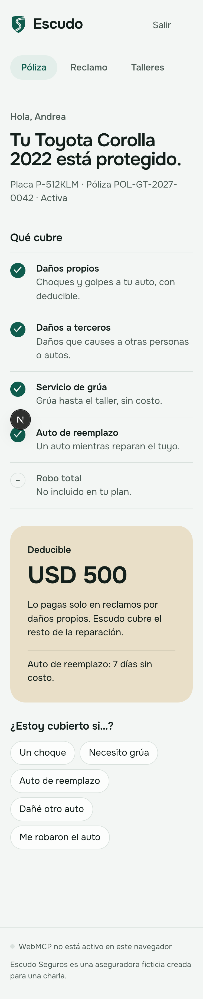
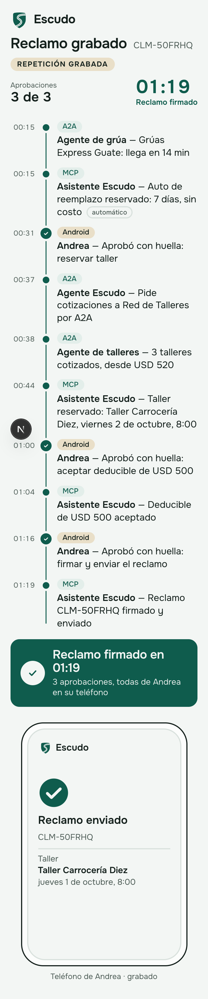

# Escudo — an agent-ready car insurer

> Demo for the talk **"Built for Agents: Making Your Apps Usable by AI"** · [Español](README.md)

Escudo is a fictional Guatemalan car insurer that AI agents can use from an **Android app with
AppFunctions**, a **website with WebMCP**, an **MCP server** and a **chat**; its agent delegates tow
and repair to partners over **A2A**. From "I had a minor crash, help me with everything" to a signed
claim, with **exactly three fingerprint approvals**.

## What you'll learn

- **Functions, not screens:** 11 capabilities; every surface is a thin adapter over them.
- **Autonomy vs. approval:** a server-side table decides what the agent may do alone; approving is never a tool.
- **MCP vs. A2A:** tools over MCP; other companies' work over A2A, discovered through their Agent Card.
- **AppFunctions and WebMCP:** the app and the site as tools for the system's and the browser's agents.

[](docs/diagrams/architecture.svg)
[](docs/diagrams/demo-coverage.svg)

## 60-Minute Interactive Codelab (Live)

- **Interactive Codelab (Firebase Hosting):** [https://built-for-agents-2027.web.app](https://built-for-agents-2027.web.app)
- **Live Codelab App (`Escudo Agent Sandbox` on Cloud Run):** [https://escudo-agent-sandbox-611681112050.us-central1.run.app](https://escudo-agent-sandbox-611681112050.us-central1.run.app)
- **Runnable Codelab code and test suite:** [`codelab/demo-app/`](codelab/demo-app/) (`node --test codelab/demo-app/gate.test.mjs`)

## Quickstart

```bash
echo "sdk.dir=$HOME/Library/Android/sdk" >> android/local.properties  # once
make up-mock                 # cloud-free API on :8080
make scenario                # another terminal: the scenario over MCP, 3 approvals
make chat-scenario           # the same flow over the chat
make test                    # backend, Android and web
make chat-scenario CLOUD=1   # cloud: prints …/presentador?run=<id>
```

On talk day nothing is run: you open the [presenter](https://escudo-web-611681112050.us-central1.run.app/presentador)
(it wakes the services, which shut down by themselves when nobody uses them) and the `Pixel_9_API_36_1`
emulator, which already has the app ready. **Empezar de nuevo** (start over), on the app's Policy screen,
puts everything back in its initial state. Script: [docs/DEMO.en.md](docs/DEMO.en.md).

## What is the product and what is only for the talk

- **The product, anyone can try it:** the Escudo Android app and the web portal
  https://escudo-web-611681112050.us-central1.run.app/ (policy, claim and repair shops, with the WebMCP
  tools). They work on phones, tablets and computers.
- **Only for the live demo:** the presenter view,
  https://escudo-web-611681112050.us-central1.run.app/presentador. It is the projector screen: it shows,
  in large type, what the agents do while the customer uses the app. It is not part of the product. On
  a phone it reflows into a single column. `/presenter` redirects there.

| Portal on a phone | Presenter on a phone |
| --- | --- |
|  |  |

## Deployed URLs

| What | URL |
| --- | --- |
| API · MCP · chat | https://escudo-api-611681112050.us-central1.run.app (`/health`, `/mcp`, `wss://…/assistant/chat`) |
| Agent Cards | https://escudo-api-611681112050.us-central1.run.app/a2a/escudo/.well-known/agent-card.json (also `/a2a/tow/…`, `/a2a/repair/…`) |
| Portal (product) | https://escudo-web-611681112050.us-central1.run.app/ |
| Presenter (talk only) | https://escudo-web-611681112050.us-central1.run.app/presentador (`?demo=1`: recorded replay) |

## Documentation

- [Demo script](docs/DEMO.en.md): step by step, with screenshots ([Spanish](docs/DEMO.md))
- [Onboarding guide (Spanish)](docs/ONBOARDING.md): setup, cloud, tests, troubleshooting
- [Architecture](docs/ARQUITECTURA.en.md) · [Commands](docs/COMANDOS.en.md) · [Repo structure](docs/ESTRUCTURA.en.md)
- [Technical decisions and versions](docs/DECISIONES.en.md) · [Credits and provenance](docs/CREDITOS.en.md)
- Contracts: [tools](contracts/tools.md), [REST API](contracts/openapi.yaml), [events](contracts/events.schema.json)

## Use your own Google Cloud project

The `infra/` scripts read `PROJECT_ID` (the talk's project by default). To deploy to yours:
`PROJECT_ID=<your-project> make infra && PROJECT_ID=<your-project> make deploy`, and put the same ID in
`.env` and `web/.env.local`. Details in the [onboarding guide](docs/ONBOARDING.md) (Spanish).

## License

Code under [Apache 2.0](LICENSE). The Onest typeface is SIL OFL 1.1; images are synthetic and all data is
fictional ([NOTICE](NOTICE), [credits](docs/CREDITOS.en.md)).
