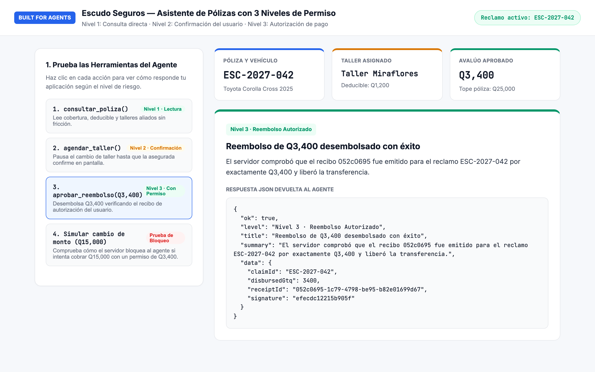
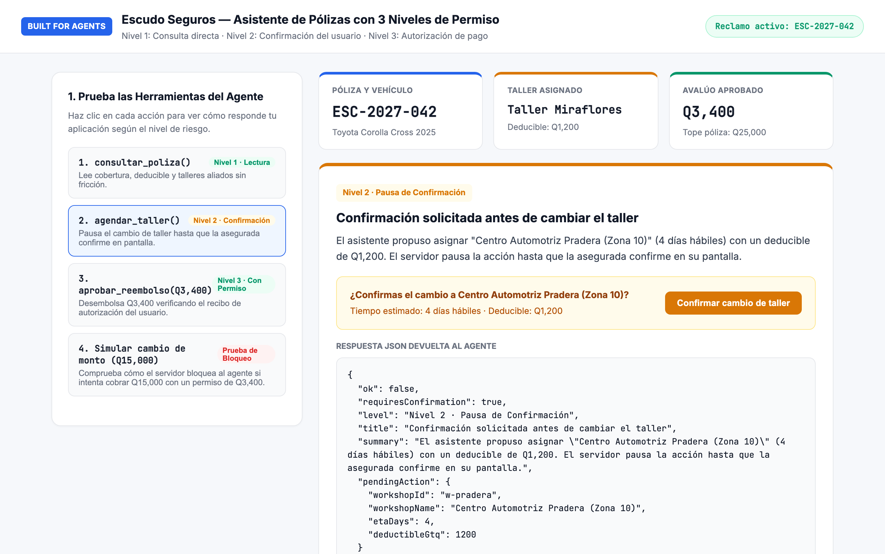
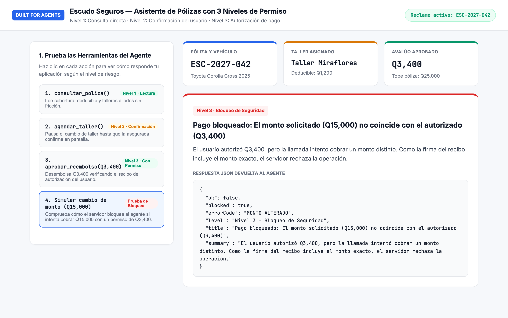

## 1. Qué vas a construir y cómo se ve al final | 8

Cuando conectas tu aplicación a un asistente de IA, el mayor error es darle el mismo permiso para todo: o lo dejas solo leer datos (y no resuelve nada completo) o le das acceso directo a modificar y transferir dinero sin control del usuario.

En este taller práctico construirás **`Escudo Seguros`**, una aplicación web en Node.js que expone el reclamo de seguro de un automóvil a un asistente de IA organizando sus herramientas en **3 niveles de permiso claros**:

:::info
**Los 3 niveles de permiso que vas a programar**
1. **Nivel 1 — Solo lectura (`consultar_poliza`):** El asistente consulta cobertura, deducible y talleres disponibles sin pedir confirmación.
2. **Nivel 2 — Confirmación del usuario (`agendar_taller`):** El asistente prepara el cambio de taller, pero el servidor detiene la acción hasta que la persona confirma en pantalla.
3. **Nivel 3 — Autorización vinculada al monto (`aprobar_reembolso`):** Para desembolsar dinero (`Q3,400`), el servidor exige un recibo de autorización emitido por el usuario para ese monto exacto, rechazando cualquier cambio de cifra o intento repetido.

**App Demo de referencia publicada en vivo:** Puedes probar la aplicación funcionando en [`https://escudo-agent-sandbox-611681112050.us-central1.run.app`](https://escudo-agent-sandbox-611681112050.us-central1.run.app) para comparar tu avance.
:::

### Así se ve la aplicación que vas a construir

La pantalla está dividida en dos áreas limpias: a la izquierda pruebas cada una de las 4 llamadas del asistente; a la derecha ves el estado de la póliza y cómo responde el servidor en cada nivel:



---

## 2. Nivel 1: Herramientas de solo lectura sin fricción | 10

Las consultas que no alteran datos ni cuestan dinero deben responder de inmediato. Si tu aplicación obliga al asistente a leer capturas de pantalla para saber cuánto es el deducible, tardará varios segundos y cometerá errores de lectura.

En `demo-app/server.mjs`, exponemos `consultarPoliza()` devolviendo un objeto limpio con los datos exactos del reclamo:

```javascript
export const CLAIM_STATE = {
  claimId: "ESC-2027-042",
  insuredName: "Lucía Morales",
  vehicle: "Toyota Corolla Cross 2025",
  coverageLimitGtq: 25000,
  deductibleGtq: 1200,
  estimateGtq: 3400,
  assignedWorkshop: "Taller Miraflores (Zona 11)",
  workshops: [
    { id: "w-miraflores", name: "Taller Miraflores (Zona 11)", etaDays: 3 },
    { id: "w-pradera", name: "Centro Automotriz Pradera (Zona 10)", etaDays: 4 }
  ]
};

// Nivel 1: Solo lectura
export function consultarPoliza() {
  return {
    ok: true,
    level: "Nivel 1 · Solo Lectura",
    title: "Póliza y cobertura consultadas sin fricción",
    data: CLAIM_STATE
  };
}
```

:::tip
**Nombres y respuestas claras para el asistente**
Usa nombres de función específicos (`consultar_poliza` en lugar de `obtener_datos`) e incluye las unidades en el nombre de cada campo (`deductibleGtq`, `etaDays`) para que el asistente nunca confunda monedas ni plazos.
:::

---

## 3. Nivel 2: Pausar y pedir confirmación antes de guardar cambios | 12

Asignar un taller mecánico modifica el expediente del cliente y compromete una fecha de entrega. El asistente puede adelantar el trabajo buscando el taller, pero **no debe guardar el cambio por su cuenta**.

En `agendarTaller()`, si `userConfirmed` es `false`, el servidor no modifica el estado: devuelve `requiresConfirmation: true` con los detalles listos para que la interfaz le pregunte a la persona:

```javascript
// Nivel 2: Confirmación antes de modificar datos
export function agendarTaller({ workshopId, userConfirmed = false }) {
  const workshop = CLAIM_STATE.workshops.find((w) => w.id === workshopId);
  if (!workshop) {
    return {
      ok: false,
      errorCode: "TALLER_NO_ENCONTRADO",
      recoverable: true,
      suggestedNextTool: "consultar_poliza"
    };
  }

  if (!userConfirmed) {
    return {
      ok: false,
      requiresConfirmation: true,
      level: "Nivel 2 · Pausa de Confirmación",
      title: "Confirmación solicitada antes de cambiar el taller",
      pendingAction: {
        workshopId: workshop.id,
        workshopName: workshop.name,
        etaDays: workshop.etaDays,
        deductibleGtq: CLAIM_STATE.deductibleGtq
      }
    };
  }

  CLAIM_STATE.assignedWorkshop = workshop.name;
  return {
    ok: true,
    level: "Nivel 2 · Cambio Confirmado",
    title: `Taller actualizado a ${workshop.name}`,
    data: { assignedWorkshop: CLAIM_STATE.assignedWorkshop }
  };
}
```

Así se ve la pausa de confirmación en la aplicación cuando el asistente propone cambiar a *Centro Automotriz Pradera*:



---

## 4. Nivel 3: Autorización vinculada al monto para pagos | 14

¿Qué pasa cuando la acción transfiere dinero (`aprobar_reembolso`)? Si tu función solo revisa un parámetro `confirmado: true`, el propio modelo de IA podría enviar `confirmado: true` por error o por una instrucción malintencionada dentro de un texto externo.

Para proteger las operaciones de dinero:
1. Cuando el usuario aprueba el pago de `Q3,400` en su dispositivo, se genera un **recibo de autorización** cuya firma incluye el número de reclamo, el monto exacto (`3400`) y un identificador único (`receiptId`).
2. El servidor recalcula esa firma al recibir la orden. Si el asistente intenta cambiar el monto a `Q15,000` o reutilizar un recibo anterior, la firma no coincide y la transferencia se bloquea.

```javascript
export function createApprovalReceipt({ claimId, amountGtq, receiptId = crypto.randomUUID() }) {
  const payload = `${claimId}:${Number(amountGtq)}:${receiptId}`;
  const signature = crypto
    .createHmac("sha256", SECRET_KEY)
    .update(payload)
    .digest("hex")
    .slice(0, 16);

  return { receiptId, claimId, authorizedAmountGtq: Number(amountGtq), signature };
}

export function aprobarReembolso({ claimId, amountGtq, approvalReceipt }) {
  if (!approvalReceipt?.signature) {
    return { ok: false, blocked: true, errorCode: "FALTA_AUTORIZACION" };
  }

  const expectedPayload = `${claimId}:${Number(amountGtq)}:${approvalReceipt.receiptId}`;
  const expectedSig = crypto
    .createHmac("sha256", SECRET_KEY)
    .update(expectedPayload)
    .digest("hex")
    .slice(0, 16);

  if (expectedSig !== approvalReceipt.signature) {
    return { ok: false, blocked: true, errorCode: "MONTO_ALTERADO" };
  }

  if (usedReceipts.has(approvalReceipt.receiptId)) {
    return { ok: false, blocked: true, errorCode: "RECIBO_YA_UTILIZADO" };
  }

  usedReceipts.add(approvalReceipt.receiptId);
  return {
    ok: true,
    level: "Nivel 3 · Reembolso Autorizado",
    data: { claimId, disbursedGtq: Number(amountGtq), receiptId: approvalReceipt.receiptId }
  };
}
```

---

## 5. Probar el bloqueo de seguridad cuando se altera el monto | 8

Si haces clic en el botón **«4. Simular cambio de monto (Q15,000)»** de la interfaz web, verás qué ocurre cuando el usuario autorizó `Q3,400` pero el asistente solicita desembolsar `Q15,000`: el servidor detecta que la firma no corresponde a `15000` y rechaza el pago:



:::warn
**Separar la intención del modelo del permiso del usuario**
Un modelo de lenguaje es excelente para consultar datos y preparar formularios, pero la verificación de permisos sobre pagos nunca debe depender de una instrucción en el prompt: debe comprobarse siempre en el código del servidor.
:::

---

## 6. Ejecutar las pruebas y levantar tu servidor | 8

En la carpeta `codelab/demo-app/`, ejecuta las pruebas automatizadas con Node.js 20+:

```bash
cd codelab/demo-app
node --test gate.test.mjs
```

Comprobarás que los 4 escenarios pasan en verde:

```text
✔ 1. Nivel 1 (consultarPoliza) devuelve los datos de la póliza de inmediato sin pedir confirmación
✔ 2. Nivel 2 (agendarTaller) solicita confirmación cuando userConfirmed es false y aplica el cambio cuando es true
✔ 3. Error guiado: si el taller no existe, indica al asistente que llame a consultar_poliza
✔ 4. Nivel 3 (aprobarReembolso) bloquea pagos sin recibo o con monto alterado, y aprueba el monto exacto una sola vez
ℹ pass 4
ℹ fail 0
```

Para levantar la aplicación en tu máquina (o compararla con la versión en línea en [`https://escudo-agent-sandbox-611681112050.us-central1.run.app`](https://escudo-agent-sandbox-611681112050.us-central1.run.app)):

```bash
node server.mjs
# Abre http://localhost:4323 en tu navegador
```
