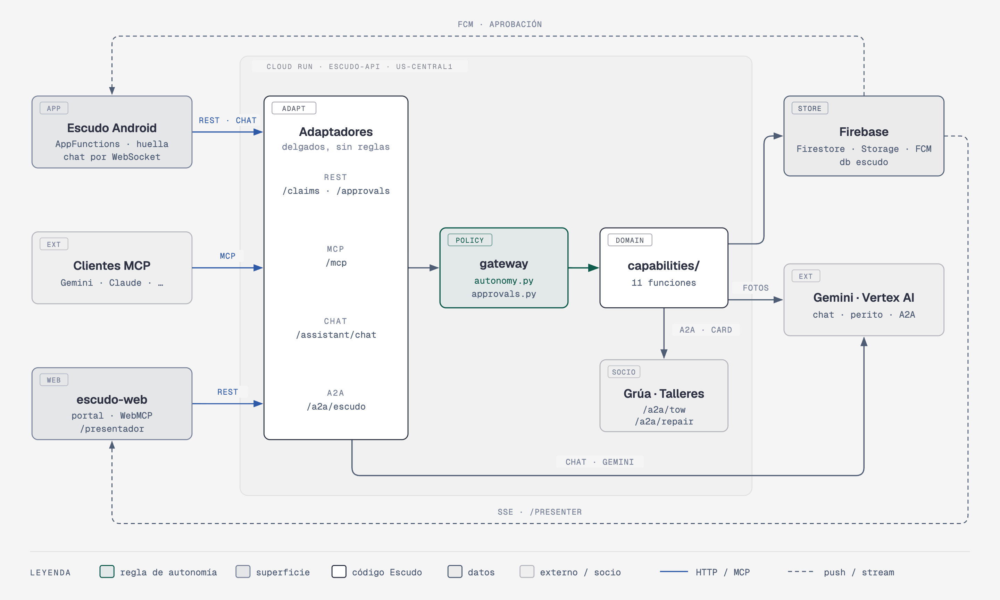
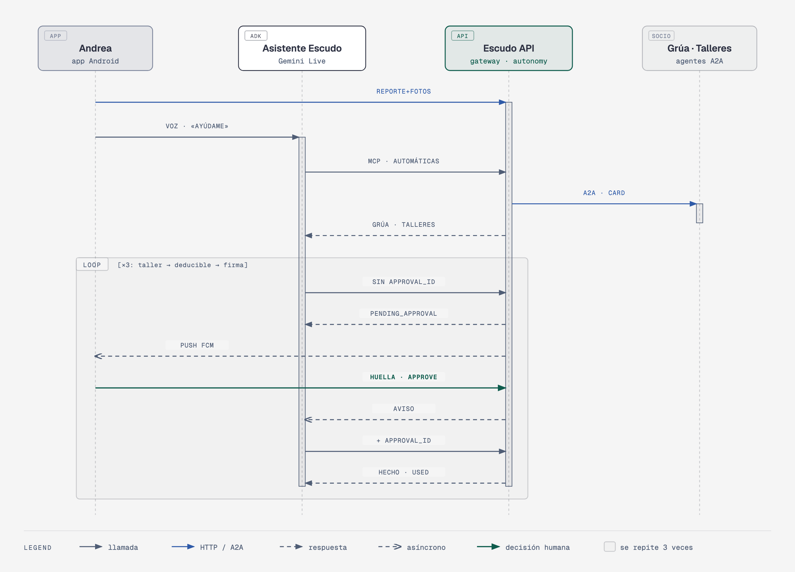
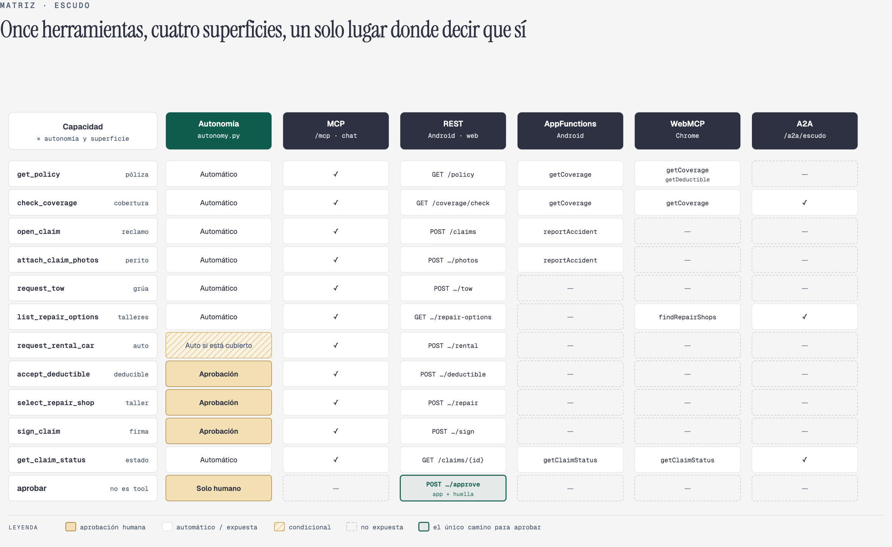
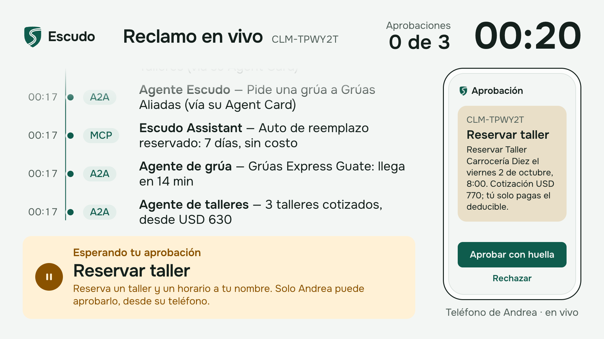

# Escudo: arquitectura y dónde está cada idea

> [README](../README.md) · [English](ARQUITECTURA.en.md)

## Qué enseña y dónde se ve en el código

| Idea | Dónde se ve en el código |
| --- | --- |
| **Funciones, no pantallas.** El dominio son 11 funciones; cada superficie es un adaptador delgado sobre ellas. | `backend/escudo/capabilities/` (un archivo por capacidad, registro en `capabilities/__init__.py`). Adaptadores: `adapters/rest.py`, `adapters/mcp_server.py`, `adapters/assistant_chat.py`, `agents/escudo_agent.py`. Todos entran por una sola puerta: `gateway.call_capability`. En Android, pantallas y AppFunctions usan el mismo `EscudoRepository`; en la web, pantallas y WebMCP usan el mismo `api()` |
| **Qué puede hacer un agente solo y qué necesita a una persona.** Una tabla, aplicada por el servidor, no por el prompt. | `backend/escudo/autonomy.py` (tabla `AUTONOMY` + `enforce()`), `approvals.py` (aprobación de un solo uso atada a herramienta + hash de argumentos). Aprobar **nunca** es una herramienta: solo existe `POST /approvals/{id}/approve`, que llama la app tras `BiometricPrompt` (`android/.../approvals/ApprovalFlow.kt`) |
| **Dónde encaja MCP y dónde A2A.** Herramientas por MCP; trabajo de otras empresas por A2A, descubierto por Agent Card. | MCP: `adapters/mcp_server.py` (`/mcp`, streamable HTTP). A2A: `agents/hosting.py` (Agent Card en `/.well-known/agent-card.json`), `agents/peers.py` (descubrimiento desde `A2A_PEERS`), `agents/tow_agent.py`, `agents/repair_agent.py` |
| **AppFunctions**: la app Android como herramienta para agentes del sistema. | `android/app/src/main/kotlin/app/escudo/android/appfunctions/EscudoAppFunctions.kt` (`reportAccident`, `getCoverage`, `getClaimStatus`), descripción para agentes en `res/xml/app_metadata.xml`. Ver [`android/APPFUNCTIONS.md`](../android/APPFUNCTIONS.md) |
| **WebMCP**: el sitio web como herramienta para el agente del navegador. | `web/src/lib/webmcp.ts` (`getCoverage`, `getDeductible`, `findRepairShops`, `getClaimStatus`, todas de solo lectura) y `web/src/components/portal/WebMcpTools.tsx` (registro con `document.modelContext.registerTool`) |
| **Un asistente de chat** con exactamente los mismos poderes —y las mismas pausas— que cualquier cliente MCP. | `backend/escudo/adapters/assistant_chat.py` (ADK `LlmAgent` sobre `GEMINI_MODEL` + `McpToolset` en *loopback* a `/mcp` con el token de la clienta; transcripción en Firestore; tras una aprobación el asistente sigue solo). En Android: `assistant/ChatSession.kt`, `assistant/ChatProtocol.kt` |

## Arquitectura

([SVG](diagrams/architecture.svg) · [HTML](diagrams/architecture.html))

- **`escudo-api`** (Cloud Run): un proceso FastAPI con REST, MCP (`/mcp`), el chat del asistente
  (`/assistant/chat`) y tres agentes A2A (`/a2a/escudo`, `/a2a/tow`, `/a2a/repair`). Cada llamada pasa
  por `gateway.call_capability`, que valida la entrada, corre el *precheck*, aplica `autonomy.py`,
  ejecuta la capacidad y escribe los eventos de la línea de tiempo (validados contra
  `contracts/events.schema.json`).
- **`escudo-web`** (Cloud Run): portal de la clienta con WebMCP y la vista `/presentador`, que lee
  Firestore en el servidor y lo envía al navegador por Server-Sent Events.
- **Escudo para Android** (teléfono o emulador): póliza, reclamo, aprobaciones con huella, chat con el
  Asistente Escudo, push FCM y AppFunctions.
- **Firebase**: Auth (login de la clienta), Firestore (base `escudo`), Cloud Storage (fotos del
  reclamo en `ai-experiments-487722-escudo-claims`) y FCM (push de aprobación). Vertex AI aporta Gemini.

### El escenario, paso a paso

1. Andrea reporta el accidente en la app con tres fotos (`open_claim` + `attach_claim_photos`); el
   perito de daños (Gemini multimodal con salida estructurada) devuelve piezas, severidad y rango de costo.
2. Le escribe al Asistente Escudo «ayúdame con todo». El asistente llama, sin pedir permiso,
   `request_tow` y `list_repair_options` (el agente Escudo delega por A2A en Grúas Aliadas y la Red de
   Talleres) y `request_rental_car` (automático porque la póliza sembrada lo cubre).
3. Tres veces —`select_repair_shop`, `accept_deductible`, `sign_claim`— la herramienta devuelve
   `pending_approval` sin cambiar nada; llega un push, Andrea aprueba con la huella, el chat (que vigila
   esa aprobación en Firestore) envía `approval_resolved` y el asistente, solo, repite la misma llamada
   con el `approval_id`.

### Herramientas, autonomía y superficies

La tabla completa, con entradas y salidas, está en [`contracts/tools.md`](../contracts/tools.md).

## URLs desplegadas

| Qué | URL |
| --- | --- |
| API | https://escudo-api-611681112050.us-central1.run.app (`/health`) |
| MCP | https://escudo-api-611681112050.us-central1.run.app/mcp (bearer: ID token de Firebase) |
| Agent Cards | https://escudo-api-611681112050.us-central1.run.app/a2a/escudo/.well-known/agent-card.json (también `/a2a/tow/…` y `/a2a/repair/…`) |
| Chat | `wss://escudo-api-611681112050.us-central1.run.app/assistant/chat` (cabecera `Authorization`) |
| Portal | https://escudo-web-611681112050.us-central1.run.app/ |
| Presentador | https://escudo-web-611681112050.us-central1.run.app/presentador (`?run=<id>` sigue una corrida; `?demo=1` reproduce una grabada sin nube, rotulada REPETICIÓN GRABADA) |

