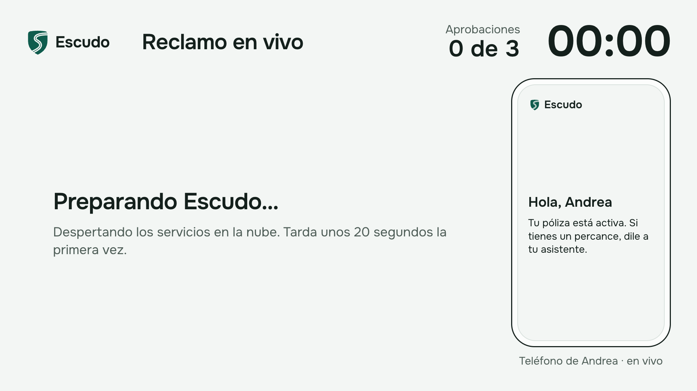
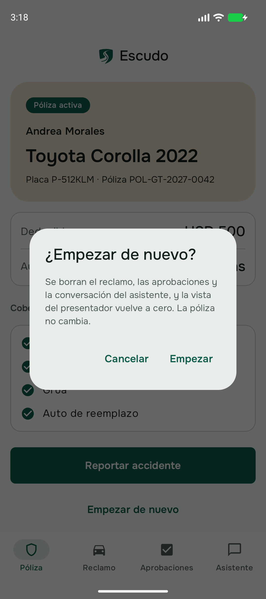
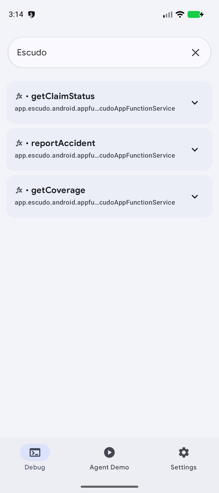
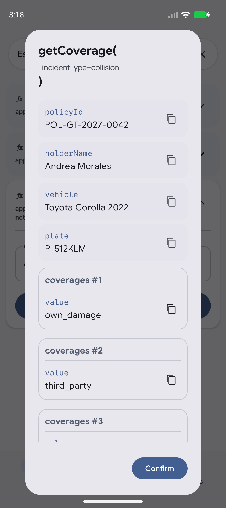

# Escudo: demo script

The live walkthrough for the talk, screen by screen: from "I had a crash" to a signed claim, with
exactly three fingerprint approvals. Two one-minute extras follow: the app and the site as tools for any
agent (AppFunctions and WebMCP). The app, the presenter and the assistant speak Spanish; their text is
quoted as it appears, with a translation where it helps. [Versión en español](DEMO.md).

On talk day no command is run: you open one page and the emulator, and everything else happens in the
app, the emulator and Chrome. Screenshots come from a run against the cloud (the claim number changes on
every run).

Main walkthrough: **about 2 minutes** of system time plus your talking (the damage assessment takes 6 to
15 s and each assistant step 7 to 25 s, depending on Gemini).

[](diagrams/demo-coverage.svg)

## What you open

| Where | What |
| --- | --- |
| Projector, full screen | Chrome: https://escudo-web-611681112050.us-central1.run.app/presentador |
| Laptop, left half | The **Pixel_9_API_36_1** emulator (Android Studio → **Device Manager** → ▶). The Escudo app is already installed and signed in, with the crash photos in the gallery and an enrolled fingerprint |
| Laptop, next to the emulator | The emulator's extended controls (the **⋯** button on its side bar) on **Fingerprint**: the **Touch sensor** button there is the fingerprint |
| Laptop, right half | Chrome with the portal at https://escudo-web-611681112050.us-central1.run.app/reclamo, for WebMCP |

The presenter view is only the projector screen for this live demo. The product, what anyone can
try, is the app and the portal (https://escudo-web-611681112050.us-central1.run.app/).

Open the presenter a few minutes before you start. The cloud services shut down by themselves when
nobody uses them; when the page opens it says **«Preparando Escudo…»** (getting Escudo ready) while it
wakes them (about 20 seconds), then **«Listo para empezar»** (ready to start).

| While it wakes up | Ready |
| --- | --- |
|  |  |

The emulator opens as it was left: unlocked, with the app on the policy. If it asks for the screen PIN,
it is **1234**.

### Start from scratch

If the presenter shows a claim from an earlier rehearsal: in the app, **Póliza** tab → **Empezar de
nuevo** (start over) → **Empezar**. The claim, the approvals and the conversation are deleted; the app goes
back to the policy and the presenter to «Listo para empezar». It takes a few seconds.



## The walkthrough

### 1. The policy (10 s)


- **Do:** show the app's **Póliza** screen.
- **Point out:** *functions, not screens*: what you see comes from `get_policy`, the same function the
  chat, MCP, AppFunctions and WebMCP use.

### 2. Report the accident (30 s)

| Picking photos | Report ready |
| --- | --- |
|  |  |

- **Do:** tap **Reportar accidente** and type in «¿Qué pasó?» (what happened?):

  ```text
  Choque menor: me chocaron por detrás mientras esperaba en el semáforo. Nadie salió herido.
  ```

  In «¿Dónde fue?» (where?):

  ```text
  Calzada Roosevelt, zona 11
  ```

  Tap **Elegir fotos de la galería**, select **the three photos of the grey Corolla** (the first three in
  the gallery), then **Done**, then **Enviar reporte**.
- **Point out:** the app shrinks the photos before uploading; nobody fills in damage forms.

### 3. Damage assessment (6 to 15 s)

| App | Presenter |
| --- | --- |
|  |  |

- **Do:** wait for the card «Reclamo CLM-… abierto · Daño moderado» (claim opened, moderate damage).
- **Point out:** opening the claim and assessing the damage are **automatic** («automático» tag on the
  presenter): the AI assessor (Gemini with structured output) needs no permission to look at photos.

### 4. Ask the assistant for everything (about 10 s to the first pause)

| Empty chat | First pause |
| --- | --- |
|  |  |

- **Do:** back → **Asistente** tab and type:

  ```text
  Tuve un choque menor, ya subí las fotos en la app. Ayúdame con todo, por favor.
  ```

  (or tap the suggestion «Tuve un choque, ayúdame con todo»). If it asks something instead of acting,
  answer `Sí, adelante con todo.`
- **Look at the projector:**

  

- **Point out**, in this order:
  1. *Agent Card*: right before the A2A rows comes «Agente Escudo — Descubre a Red de Talleres por su
     Agent Card». The agent did not know the partner: it found it through its card at
     `/.well-known/agent-card.json`.
  2. *MCP vs. A2A*: the assistant uses tools over **MCP** (tow, shops, car); work done by other companies
     (Grúas Aliadas, Red de Talleres) goes agent to agent over **A2A**.
  3. *Autonomy vs. approval*: tow, quotes and the replacement car were automatic. Booking the shop was
     **not**: the tool returned `pending_approval` and changed nothing. It stops in amber.

## The three approvals

Each follows the same pattern: a push arrives, the approval card shows exactly what will be done, you
approve with the fingerprint and the assistant carries on by itself, without you typing anything.

The fingerprint: with the fingerprint dialog on screen, press **Touch sensor** in the emulator's extended
controls (**⋯** → **Fingerprint**). If it does not react the first time, press it again: the sensor
starts listening a moment after the dialog appears.

### 5. Approval 1: book the shop (about 15 s, up to 40 s if Gemini is slow)

| Card | Fingerprint |
| --- | --- |
|  |  |

- **Do:** in the chat tap **Revisar y aprobar** (or the notification, or the **Aprobaciones** tab), then
  **Aprobar con huella**, and press **Touch sensor**.
- **Point out:** approving **is not a tool**. Only `POST /approvals/{id}/approve` exists, signed with the
  phone's key, and the approval is valid for *this* shop and *this* slot, once.
- **On the presenter:** «Andrea — Aprobó con huella: reservar taller» appears with the Android badge, the
  counter goes to **1 de 3**, the assistant books the shop and stops at the deductible:

  

### 6. Approval 2: accept the deductible (about 10 s)

| Chat | Card |
| --- | --- |
|  |  |

- **Do:** **Revisar y aprobar** → **Aprobar con huella** → **Touch sensor**.
- **Point out:** the amount (USD 500) is on the phone's card, not in the chat: the human approves what the
  server will execute, not what the model says.
- **On the presenter:** **2 de 3**, «Deducible de USD 500 aceptado» and the signing pause:

  

### 7. Approval 3: sign and send (about 10 s)

| Chat | Card |
| --- | --- |
|  |  |

- **Do:** **Revisar y aprobar** → **Aprobar con huella** → **Touch sensor**.
- **Point out:** three actions with consequences, three fingerprints. The agent did everything else.

### 8. Claim signed

| Chat | Claim |
| --- | --- |
|  |  |


- **Do:** show the **Reclamo** tab («Reclamo firmado y enviado»).
- **Point out:** the clock stopped; the green banner says «3 aprobaciones, todas de Andrea en su teléfono».

## Extras (1 min each): the app and the site as tools for any agent

They show the same capabilities outside the chat: with AppFunctions, Android offers the app's functions to
system agents; with WebMCP, the site offers tools to the browser's agent.

### AppFunctions: the app as a system tool (1 min)

Google's **AppFunction Testing Agent** is already running in the emulator: an agent outside Escudo, with
the system permission to call other apps' functions.

1. Open it from the emulator's recent apps (swipe up from the bottom bar and hold) or from its
   **AppFunction Testing Agent** icon. Tap the search box: Escudo is pinned at the top; tap it.
2. The three functions the app offers to the system appear: `getClaimStatus`, `reportAccident` and
   `getCoverage`.

   

3. Tap **getCoverage**, type `collision` in `incidentType` and tap **Run**. The agent shows the answer:
   policy `POL-GT-2027-0042`, Andrea Morales, Toyota Corolla 2022, plate `P-512KLM` and the coverages;
   further down, the USD 500 deductible. **Confirm** closes the result.

   

4. Repeat with **getClaimStatus** (no parameters): «Reclamo firmado y enviado».


- **Point out:** the presenter says **Agente externo** (external agent) with the **AppFunctions** badge,
  on the claim's own timeline. They are the same functions as the Póliza screen. There are only read and
  report functions: approving does not exist as an AppFunction.

### WebMCP: the site as a browser tool (1 min)

1. In Chrome, the portal https://escudo-web-611681112050.us-central1.run.app/reclamo signed in as
   Andrea. The footer says «WebMCP · 4 herramientas disponibles para el agente de tu navegador».
2. DevTools (`⌥⌘I`) → **Application** tab → in the side bar, *Application* section, **WebMCP**. Below,
   under **Available Tools**, `findRepairShops`, `getClaimStatus`, `getCoverage` and `getDeductible`
   appear, each with its description.
3. Pick **getDeductible**; in the **Details** panel scroll to **Run Tool** and press **Run Tool** (no
   input). At the top, in the activity, `getDeductible · Completed` appears; in the **Output** tab:

   ```json
   {"deductible_usd":500,"currency":"USD","rental_days":7,"note":"…"}
   ```


- **Point out:** all four carry the `readOnly` flag (visible in **Details → Flags**); none approves. On the
  presenter it shows as **Agente externo** with the **WebMCP** badge.

This part needs, once in that Chrome, the `chrome://flags/#enable-webmcp-testing` flag set to
**Enabled** and Andrea signed in to the portal (see [ONBOARDING.md, section
9](ONBOARDING.md#9-mostrar-appfunctions-y-webmcp), in Spanish). The browser keeps both.

## If something fails

| Symptom | What to do |
| --- | --- |
| The presenter stays on «Preparando Escudo…» for more than a minute | Reload the tab. If it persists, check the laptop's internet connection |
| The presenter says «Sin conexión con Escudo. Reintentando…» | It reconnects by itself; if it takes long, reload the tab |
| The chat says «Reconectando» or does not answer within 30 s | Leave and return to the **Asistente** tab: the conversation continues (it lives in the cloud). If it went quiet after an approval, type `sigue` |
| The fingerprint does not react | Press **Touch sensor** again; if there is no dialog, tap **Aprobar con huella** again |
| The push does not arrive | Open the **Aprobaciones** tab: the pending one is there |
| Dirty state (old claim, odd counter) | **Póliza** → **Empezar de nuevo** → **Empezar** |
| The AppFunctions testing agent is not in recents or lists no functions | Skip that extra: the emulator booted from scratch and the agent needs to be prepared again (ONBOARDING, section 9) |
| Gemini slow or down | https://escudo-web-611681112050.us-central1.run.app/presentador?demo=1: a real recorded run, labelled **REPETICIÓN GRABADA** (recorded replay). Say so out loud |
| No network | The video [`escudo-chat-run.mp4`](escudo-chat-run.mp4) (83 s, also labelled as a replay) |
| The portal says «No pudimos iniciar sesión» | Skip the WebMCP extra |

Nothing is needed after the talk: the services shut down again by themselves when nobody uses them.
