# Escudo: guion de la demo

El recorrido en vivo de la charla, pantalla por pantalla: de «tuve un choque» al reclamo firmado, con
exactamente tres aprobaciones con huella. Al final vienen dos demostraciones adicionales de un minuto:
la app y el sitio como herramientas para cualquier agente (AppFunctions y WebMCP).
Las capturas son de una corrida real contra la nube (2026-10-02, reclamo `CLM-AIMROD`); el número de
reclamo cambia en cada corrida.

Duración del recorrido principal: **unos 2 minutos** de sistema (en la corrida grabada: evaluación
8 s, primera pausa 12 s después del mensaje, de 7 a 23 s entre cada huella y la siguiente pausa, según
lo que tarde Gemini) más lo que hables. Preparación técnica completa: [ONBOARDING.md](ONBOARDING.md).

[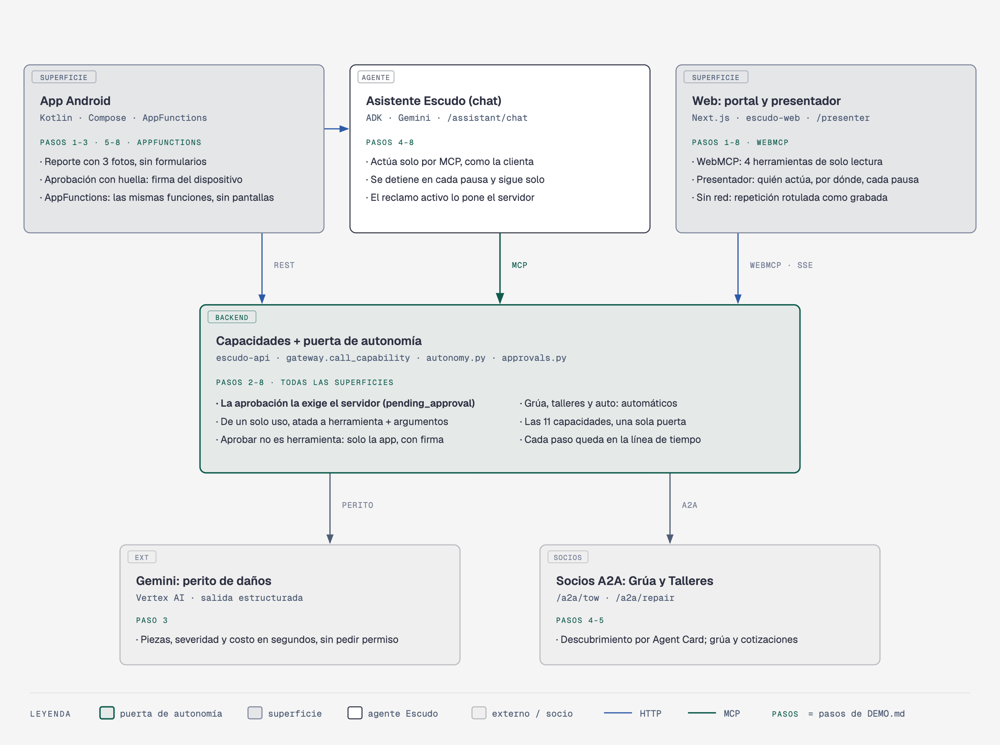](diagrams/demo-coverage.svg)

## Antes de la demo

- [ ] `make stage-on`: `escudo-api` y `escudo-web` con una instancia caliente (despliega una revisión
      nueva, por eso el warmup va después).
- [ ] `make android-prep`: arranca el emulador `Pixel_9_API_36_1` (el dispositivo del escenario) y lo deja
      listo sin pasos manuales: PIN y pantalla desbloqueada, app `live` instalada, permisos, las tres fotos
      del choque en la galería, huella registrada y la app abierta, que registra su token.
- [ ] `make warmup`: toca API, Agent Cards, portal y `/presenter`; debe terminar con `warmup OK`.
- [ ] `make reset CLOUD=1`: «Aprobaciones 0 de 3» y nada en la línea de tiempo.
- [ ] `make preflight`: debe terminar con `preflight OK` (nube caliente, Firestore en estado inicial,
      emulador listo y su dispositivo registrado). Cada falla dice qué comando la arregla.
- [ ] En la terminal de la demo, desde la raíz del repo, `export ANDROID_SERIAL=$(make -s android-serial)`:
      `adb` usa ese serial, así que los comandos de abajo no lo escriben (el puerto cambia entre arranques).
- [ ] La app abierta en **Póliza**. Ningún reporte a medias.
- [ ] Chrome con el flag de WebMCP y el portal con la sesión de Andrea ya iniciada (ONBOARDING §9).

Ventanas:

| Dónde | Qué |
| --- | --- |
| Proyector, pantalla completa | Chrome: https://escudo-web-611681112050.us-central1.run.app/presenter (sin `?run`: sigue el reclamo activo) |
| Laptop, mitad izquierda | Ventana del emulador, a tamaño legible |
| Laptop, mitad derecha arriba | Terminal con los comandos de la huella y de AppFunctions ya escritos |
| Laptop, mitad derecha abajo | Chrome con el portal (`/reclamo`) y DevTools cerrado, para la demostración de WebMCP |

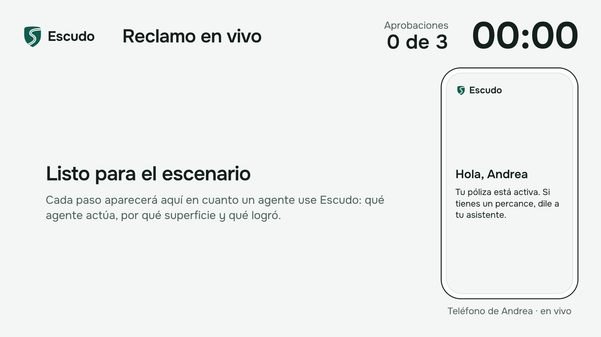

## El recorrido

### 1. La póliza (10 s)

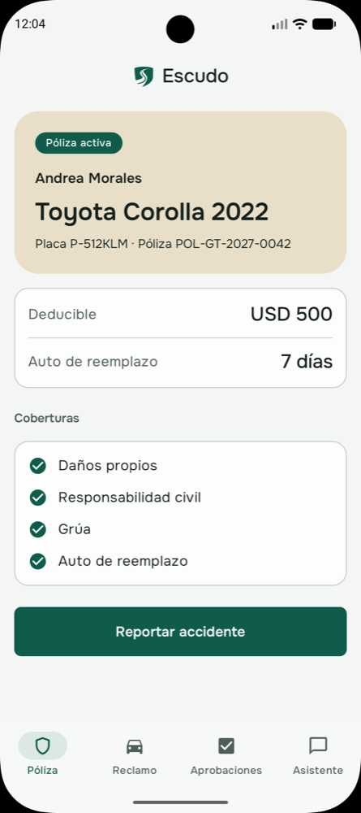

- **Haz:** muestra la pantalla **Póliza** de la app.
- **Señala:** *funciones, no pantallas*: lo que ves aquí sale de `get_policy`, la misma función que
  usan el chat, MCP, AppFunctions y WebMCP.

### 2. Reportar el accidente (30 s)

| Elegir fotos | Reporte listo |
| --- | --- |
| 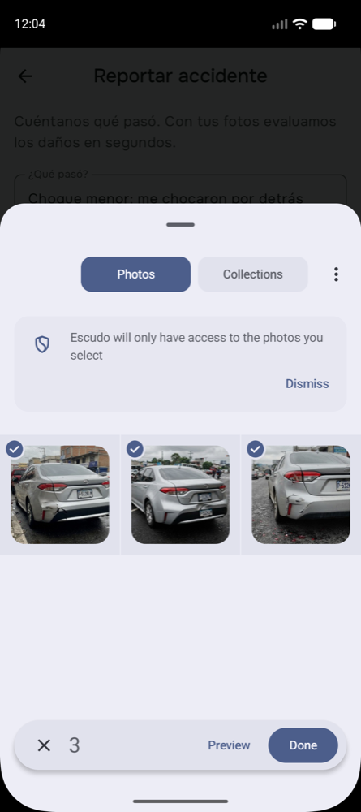 | 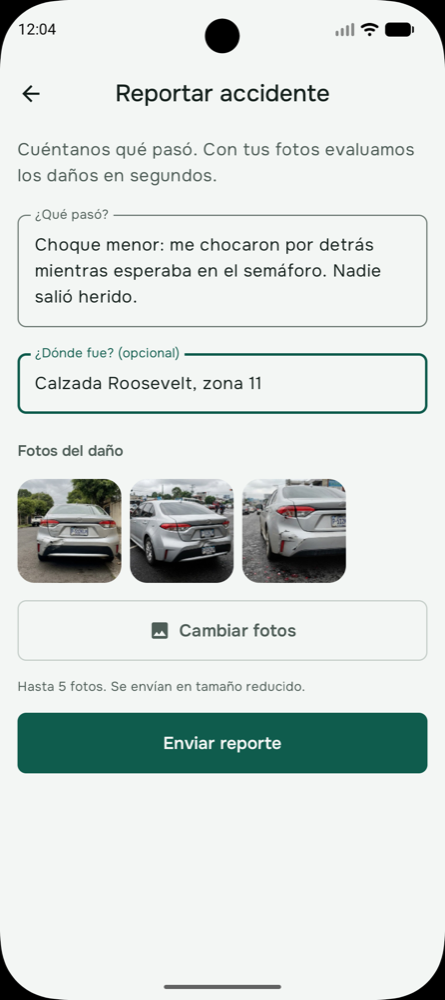 |

- **Haz:** toca **Reportar accidente** y escribe en «¿Qué pasó?»:

  ```text
  Choque menor: me chocaron por detrás mientras esperaba en el semáforo. Nadie salió herido.
  ```

  En «¿Dónde fue?»:

  ```text
  Calzada Roosevelt, zona 11
  ```

  Toca **Elegir fotos de la galería** y marca **las tres fotos del Corolla gris** (las tres primeras
  de la galería: `escudo_crash_1..3`), luego **Done**, y después **Enviar reporte**.
- **Señala:** la app reduce las fotos antes de subirlas; nadie llena formularios de daños.

### 3. Evaluación de daños (6 a 15 s)

| App | Presentador |
| --- | --- |
| 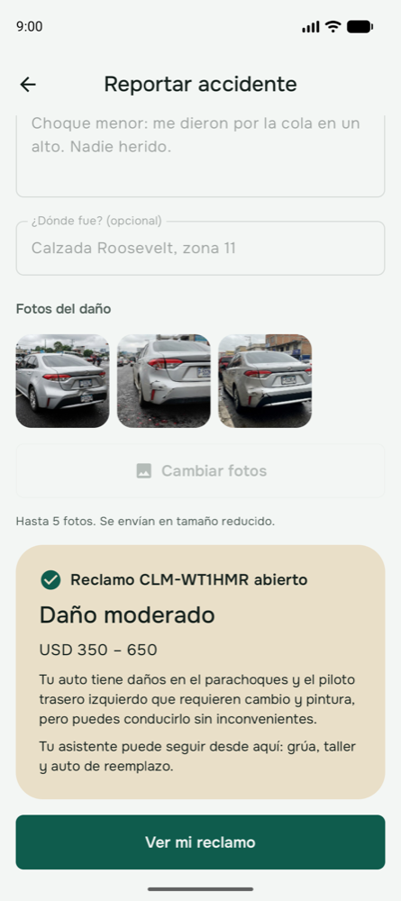 | 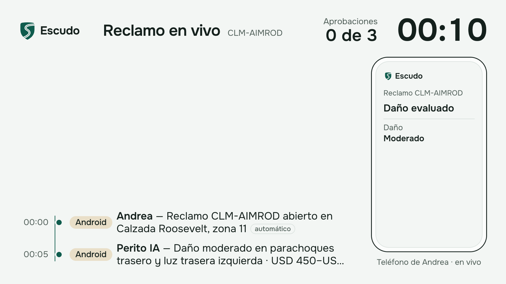 |

- **Haz:** espera la tarjeta «Reclamo CLM-… abierto · Daño moderado».
- **Señala:** abrir el reclamo y evaluar el daño son **automáticos** (etiqueta «automático» en el
  presentador): el Perito IA (Gemini con salida estructurada) no necesita permiso para mirar fotos.

### 4. Pedirle todo al asistente (unos 10 s hasta la primera pausa)

| Chat vacío | Primera pausa |
| --- | --- |
| 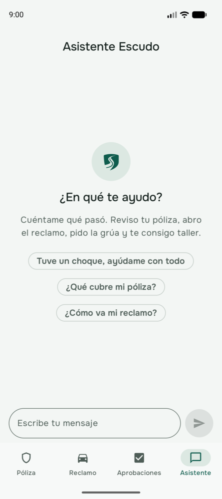 | 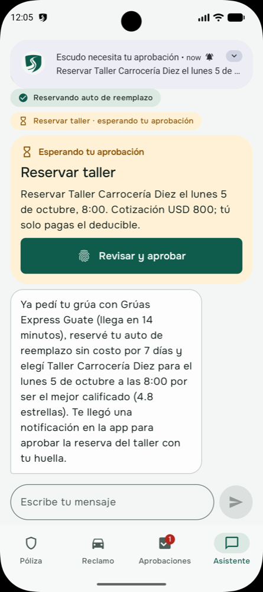 |

- **Haz:** atrás → pestaña **Asistente** y escribe:

  ```text
  Tuve un choque menor, ya subí las fotos en la app. Ayúdame con todo, por favor.
  ```

  (o toca la sugerencia «Tuve un choque, ayúdame con todo»). Si en lugar de actuar pregunta algo,
  responde `Sí, adelante con todo.`
- **Mira el proyector:**

  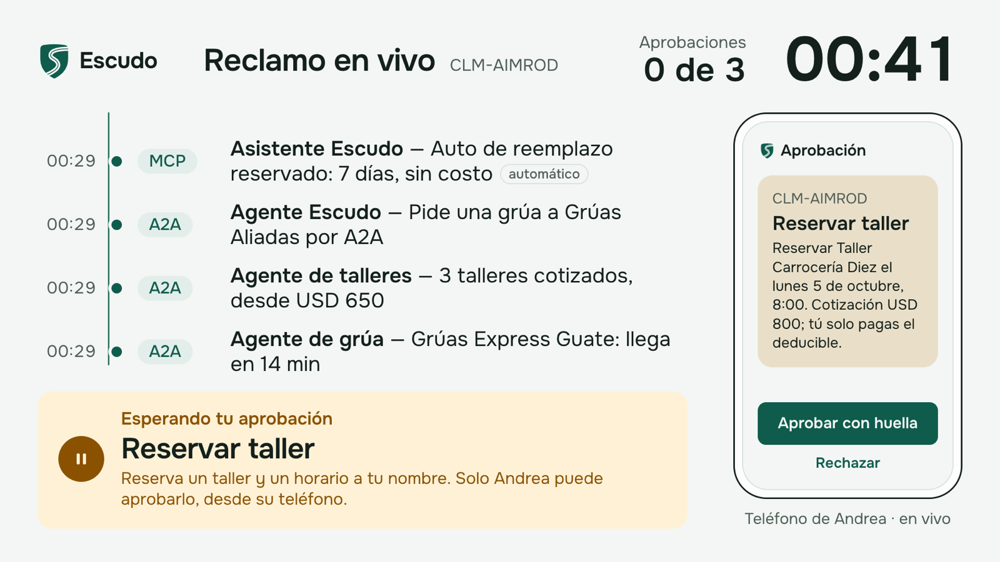

- **Señala**, en este orden:
  1. *Agent Card*: justo antes de las filas A2A pasa «Agente Escudo — Descubre a Red de Talleres por su
     Agent Card» (en la captura ya subió de la pantalla). El agente no conocía al socio: lo encontró por
     su tarjeta en `/.well-known/agent-card.json`.
  2. *MCP frente a A2A*: el asistente usa herramientas por **MCP** (grúa, talleres, auto); el trabajo de
     otras empresas (Grúas Aliadas, Red de Talleres) va de agente a agente por **A2A**.
  3. *Autonomía frente a aprobación*: grúa, cotizaciones y auto de reemplazo fueron automáticos. Reservar
     el taller **no**: la herramienta devolvió `pending_approval` y no cambió nada. Se detiene en ámbar.

## Las tres aprobaciones

Cada una sigue el mismo patrón: llega un push, la tarjeta de aprobación muestra exactamente lo que se
va a hacer, apruebas con la huella y el asistente sigue solo, sin que escribas nada.

Huella en el emulador (en la terminal con `ANDROID_SERIAL` exportado; si no responde a la primera,
repítelo: el sensor empieza a escuchar un instante después de que aparece el diálogo):

```bash
adb emu finger touch 1
```

### 5. Aprobación 1: reservar taller (unos 15 s, hasta 40 s si Gemini tarda)

| Tarjeta | Huella |
| --- | --- |
| 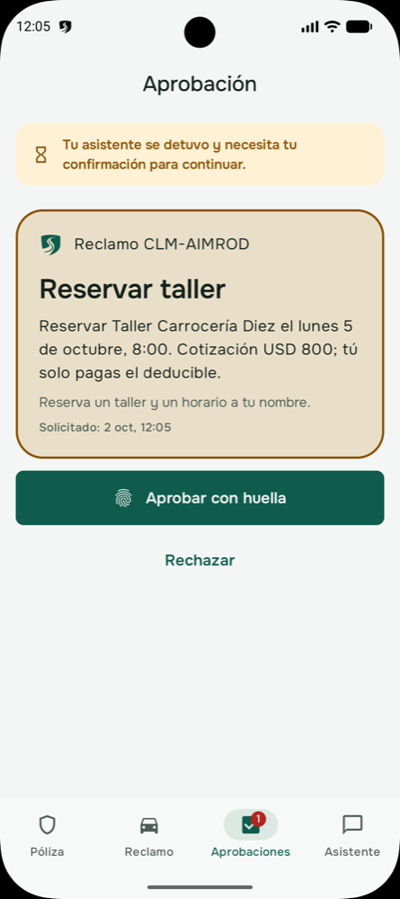 | 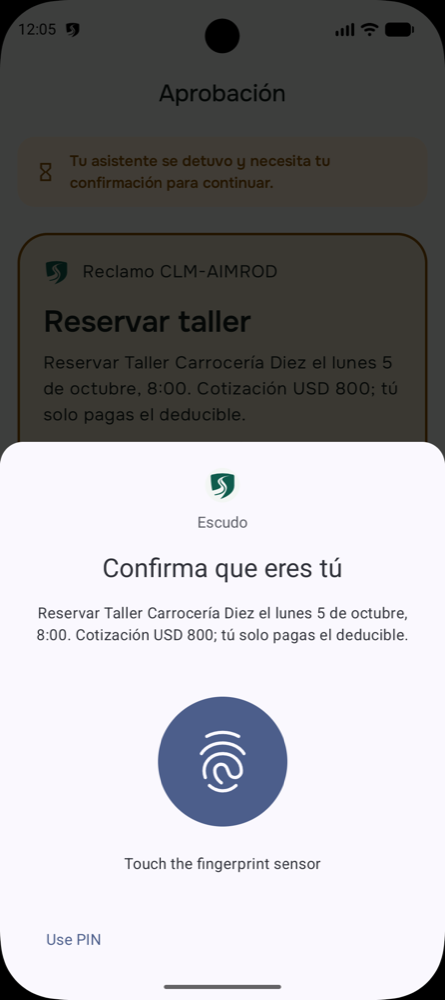 |

- **Haz:** en el chat toca **Revisar y aprobar** (o la notificación, o la pestaña **Aprobaciones**),
  luego **Aprobar con huella**, y toca el sensor con el comando de arriba.
- **Señala:** aprobar **no es una herramienta**. Solo existe `POST /approvals/{id}/approve`, firmado con
  la llave del teléfono, y la aprobación vale para *este* taller y *este* horario, una sola vez.
- **En el presentador:** aparece «Andrea — Aprobó con huella: reservar taller» con insignia Android,
  el contador pasa a **1 de 3**, el asistente reserva el taller y se detiene en el deducible:

  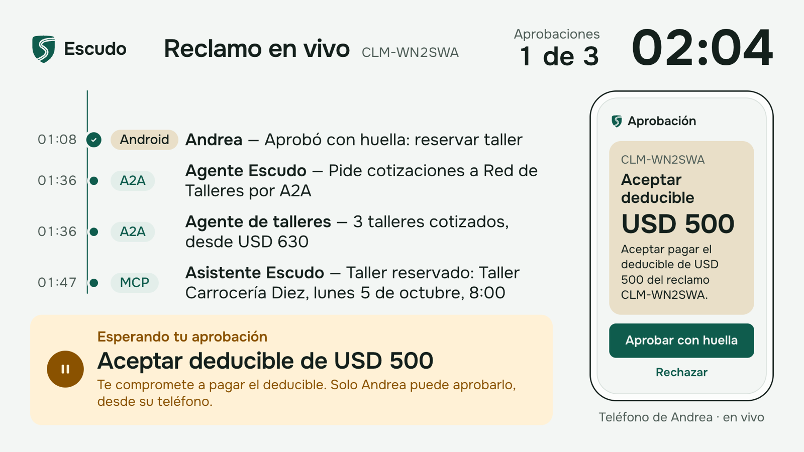

### 6. Aprobación 2: aceptar el deducible (unos 10 s)

| Chat | Tarjeta |
| --- | --- |
| 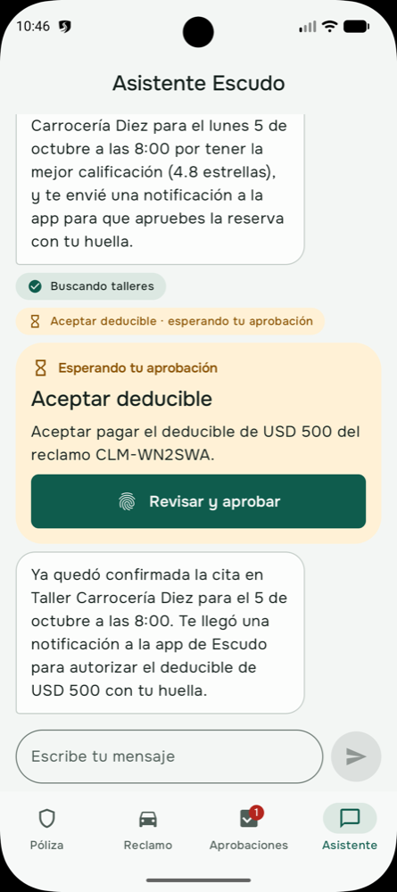 | 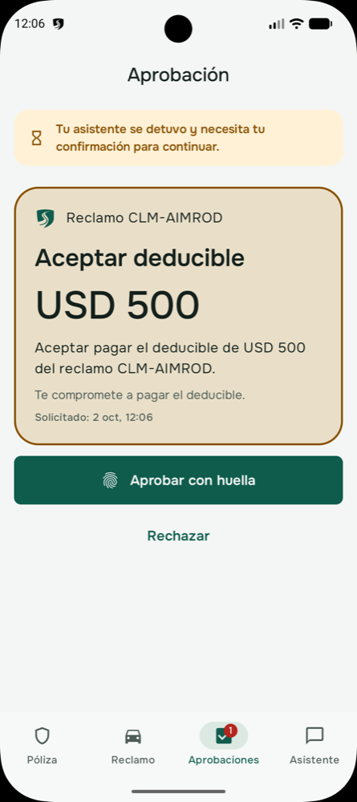 |

- **Haz:** **Revisar y aprobar** → **Aprobar con huella** → `adb emu finger touch 1`.
- **Señala:** el monto (USD 500) está en la tarjeta del teléfono, no en el chat: el humano aprueba lo
  que el servidor va a ejecutar, no lo que el modelo dice.
- **En el presentador:** **2 de 3**, «Deducible de USD 500 aceptado» y la pausa de la firma:

  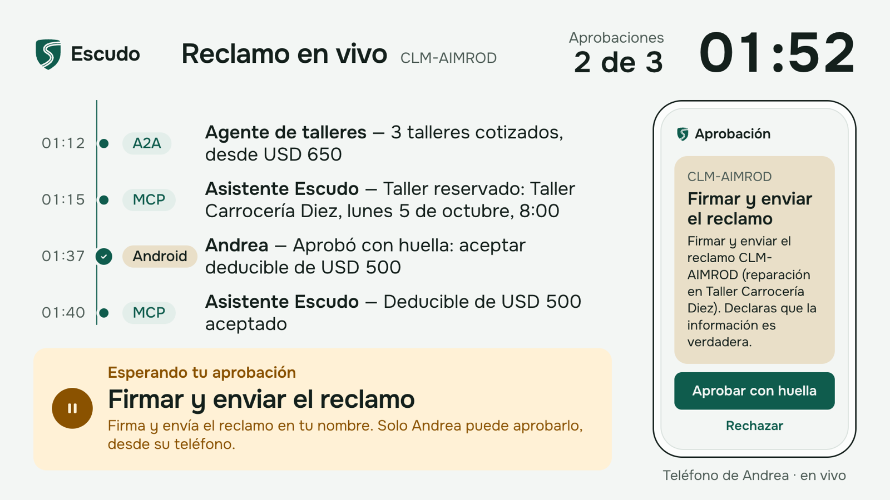

### 7. Aprobación 3: firmar y enviar (unos 10 s)

| Chat | Tarjeta |
| --- | --- |
| 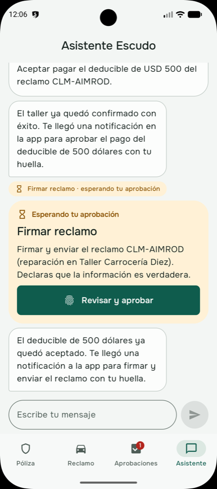 | 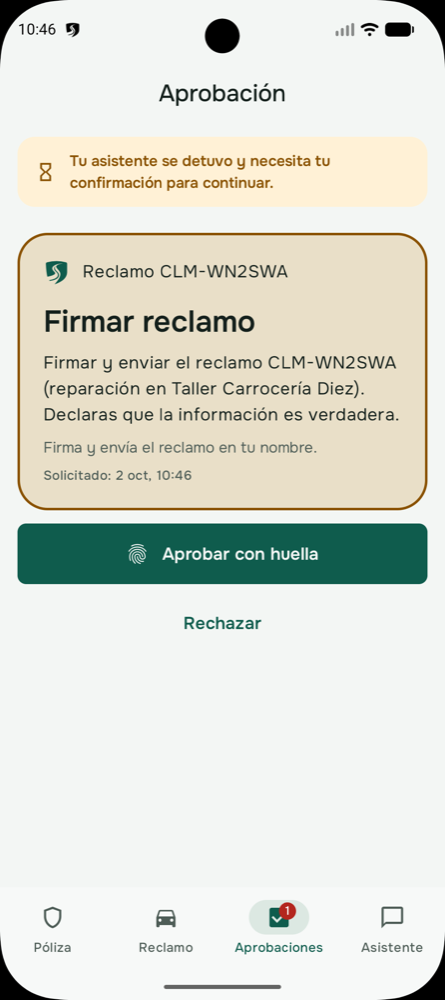 |

- **Haz:** **Revisar y aprobar** → **Aprobar con huella** → `adb emu finger touch 1`.
- **Señala:** tres acciones con consecuencias, tres huellas. Todo lo demás lo hizo el agente solo.

### 8. Reclamo firmado

| Chat | Reclamo |
| --- | --- |
| 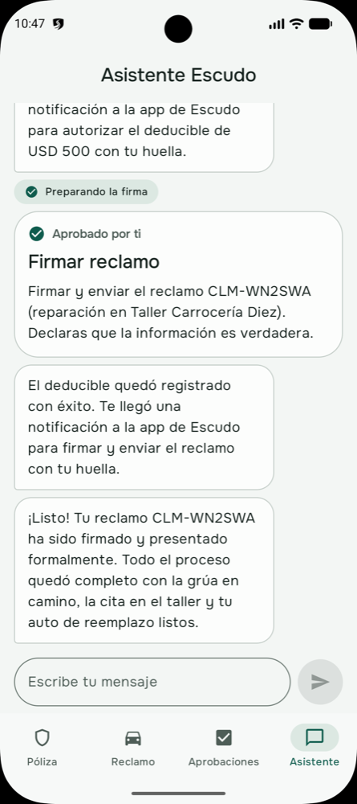 | 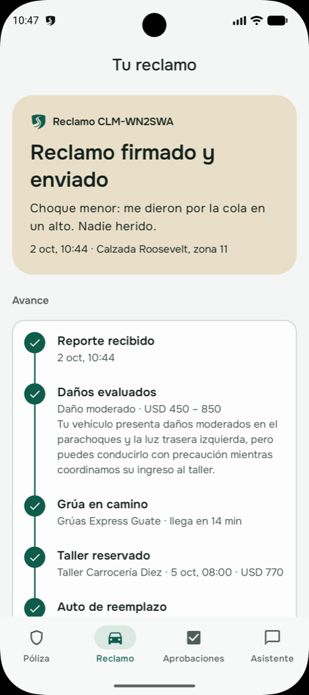 |

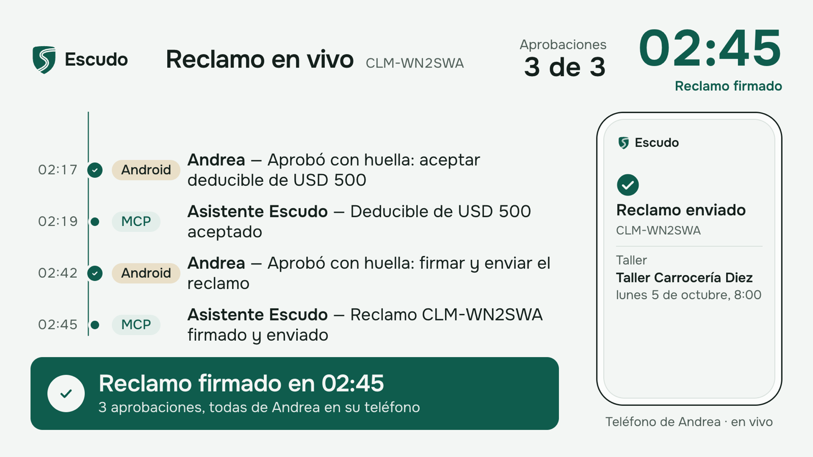

- **Haz:** muestra la pestaña **Reclamo** («Reclamo firmado y enviado»).
- **Señala:** el reloj se detuvo; el banner verde dice «3 aprobaciones, todas de Andrea en su teléfono».

## Demostraciones adicionales (1 min cada una): la app y el sitio como herramientas para cualquier agente

Muestran las mismas capacidades expuestas fuera del chat: con AppFunctions, Android ofrece funciones
de la app a los agentes del sistema; con WebMCP, el sitio ofrece herramientas al agente del navegador.

### AppFunctions: la app como herramienta del sistema (1 min)

En la terminal con `ANDROID_SERIAL` exportado (la app instalada, Android 16 QPR2):

```bash
make -C android appfunctions
```

```text
"app.escudo.android.appfunctions.BaseEscudoAppFunctionService#getClaimStatus"
"app.escudo.android.appfunctions.BaseEscudoAppFunctionService#getCoverage"
"app.escudo.android.appfunctions.BaseEscudoAppFunctionService#reportAccident"
```

```bash
F=app.escudo.android.appfunctions.BaseEscudoAppFunctionService
adb shell "cmd app_function execute-app-function --package app.escudo.android \
  --function '$F#getCoverage' --parameters '{\"incidentType\": \"collision\"}' --brief-yaml"
```

```text
androidAppfunctionsReturnValue:
  rentalDays: 7
  incidentType: collision
  active: true
  holderName: Andrea Morales
  deductibleUsd: 500.0
  notes: Cubierto por daños propios. Pagas un deducible de USD 500; Escudo cubre el resto.
  plate: P-512KLM
  vehicle: Toyota Corolla 2022
  policyId: POL-GT-2027-0042
  covered: true
  coverages:
    - own_damage
    - third_party
    - towing
    - rental_car
```

```bash
adb shell "cmd app_function execute-app-function --package app.escudo.android \
  --function '$F#getClaimStatus' --parameters '{}' --brief-yaml"
```

```text
androidAppfunctionsReturnValue:
  statusLabel: Reclamo firmado y enviado
  signed: true
  status: signed
  claimId: CLM-…
  repairShop: Taller Carrocería Diez
  …
```

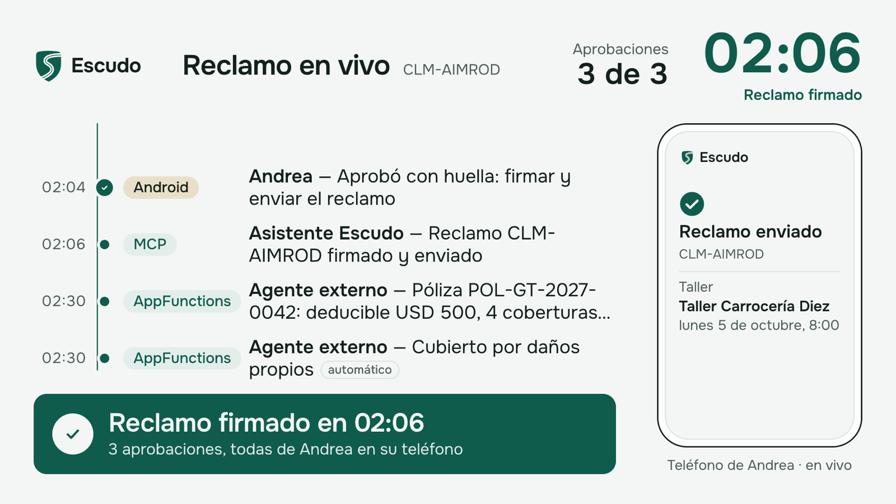

- **Señala:** quien llama es `adb`, así que el presentador dice **Agente externo** con insignia
  **AppFunctions**, en la misma línea de tiempo del reclamo. Son las mismas funciones que la pantalla
  Póliza. Solo hay funciones de lectura y de reporte: aprobar no existe como AppFunction.

### WebMCP: el sitio como herramienta del navegador (1 min)

1. Una vez antes de la charla: `chrome://flags/#enable-webmcp-testing` → **Enabled** → relanzar Chrome.
2. Abre https://escudo-web-611681112050.us-central1.run.app/reclamo con la sesión de Andrea. El pie dice
   «WebMCP · 4 herramientas disponibles para el agente de tu navegador».
3. DevTools (`⌥⌘I`) → pestaña **Application** → en la barra lateral, sección *Application*,
   **WebMCP** (marcado *NEW*). Abajo, en **Available Tools**, aparecen `findRepairShops`,
   `getClaimStatus`, `getCoverage` y `getDeductible`, cada una con su descripción.
4. Elige **getDeductible**; en el panel **Details** baja a **Run Tool** y pulsa **Run Tool** (sin
   entrada). Arriba, en la actividad, aparece `getDeductible · Completed`; en la pestaña **Output**:

   ```json
   {"deductible_usd":500,"currency":"USD","rental_days":7,"note":"…"}
   ```

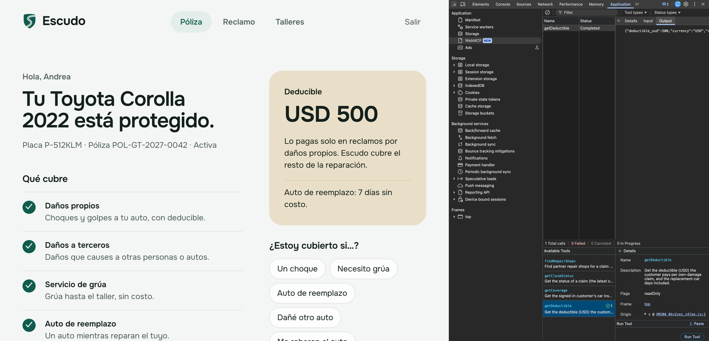

- **Señala:** las cuatro tienen la marca `readOnly` (se ve en **Details → Flags**); ninguna aprueba. En el presentador aparece como
  **Agente externo** con insignia **WebMCP**.

## Si algo falla

| Síntoma | Qué hacer |
| --- | --- |
| El presentador dice «Sin conexión con Escudo. Reintentando…» o se queda vacío | Recarga la pestaña; se reconecta solo por SSE. Si no vuelve: `make warmup` en la terminal |
| El chat dice «Reconectando» o no responde en 30 s | Sal y vuelve a la pestaña **Asistente**: la conversación sigue (vive en Firestore). Si se quedó callado tras una aprobación, escribe `sigue` |
| La huella no responde | Repite `adb emu finger touch 1`; si no hay diálogo, toca otra vez **Aprobar con huella** |
| No llega el push | Abre la pestaña **Aprobaciones**: la pendiente está ahí |
| Estado sucio (reclamo viejo, contador raro) | `make reset CLOUD=1` (< 10 s) y empieza de nuevo |
| El emulador se cuelga o no arranca a tiempo | `make chat-scenario CLOUD=1`: el mismo flujo con su propio cliente; abre el `…/presenter?run=<id>` que imprime |
| Gemini lento o caído | https://escudo-web-611681112050.us-central1.run.app/presenter?demo=1: corrida real grabada, rotulada **REPETICIÓN GRABADA**. Dilo en voz alta |
| Sin red | `make up-offline` y http://127.0.0.1:3217/presenter?demo=1 (todo local, fuentes incluidas) |
| Sin red ni laptop confiable | El video [`escudo-chat-run.mp4`](escudo-chat-run.mp4) (83 s, también rotulado como repetición) |
| El portal dice «No pudimos iniciar sesión» | Revisa los referrers de la «Escudo web key» (ONBOARDING §11); mientras tanto, salta la demostración de WebMCP |

## Después de la demo

```bash
make reset CLOUD=1
make stage-off
```
